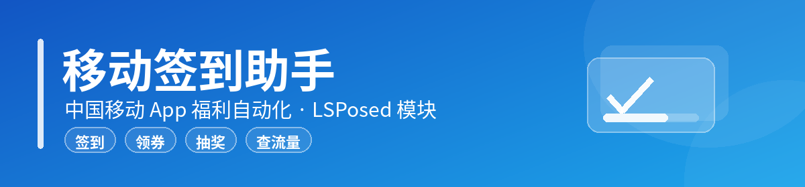
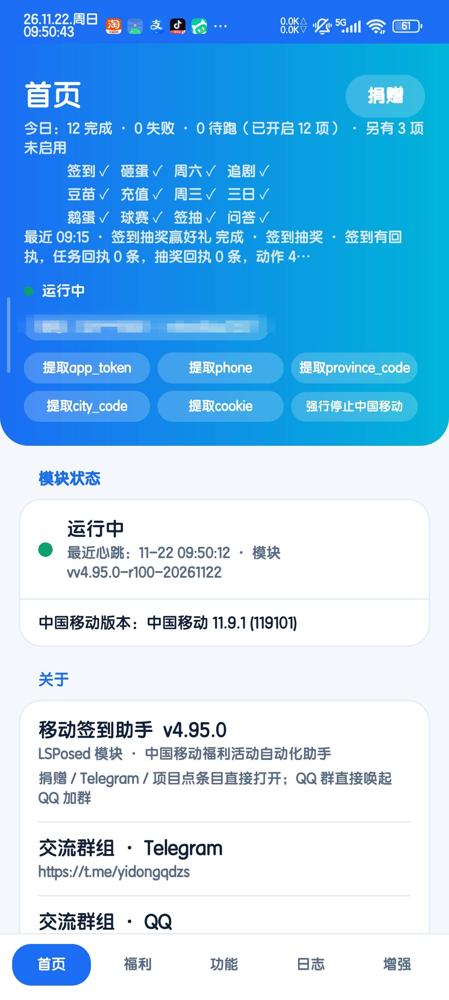
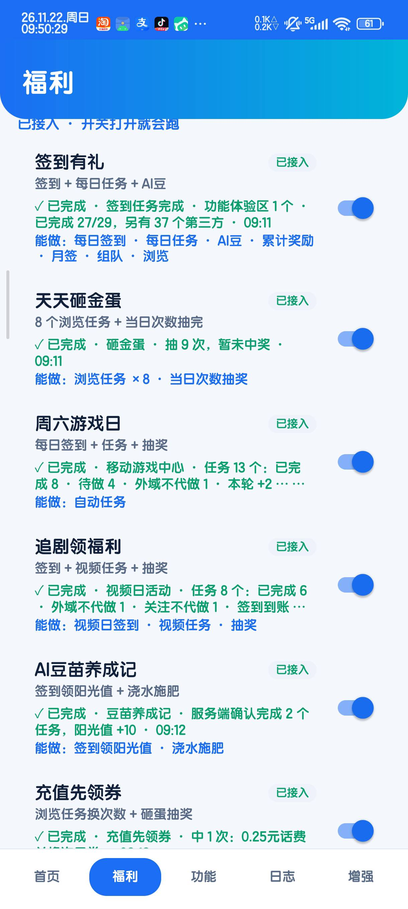
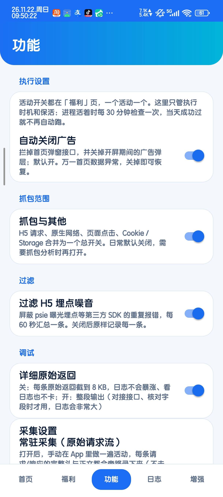
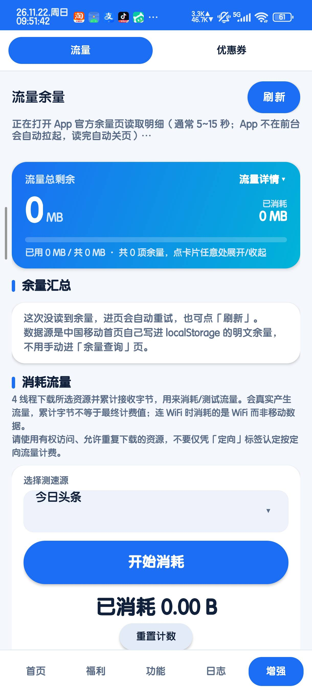
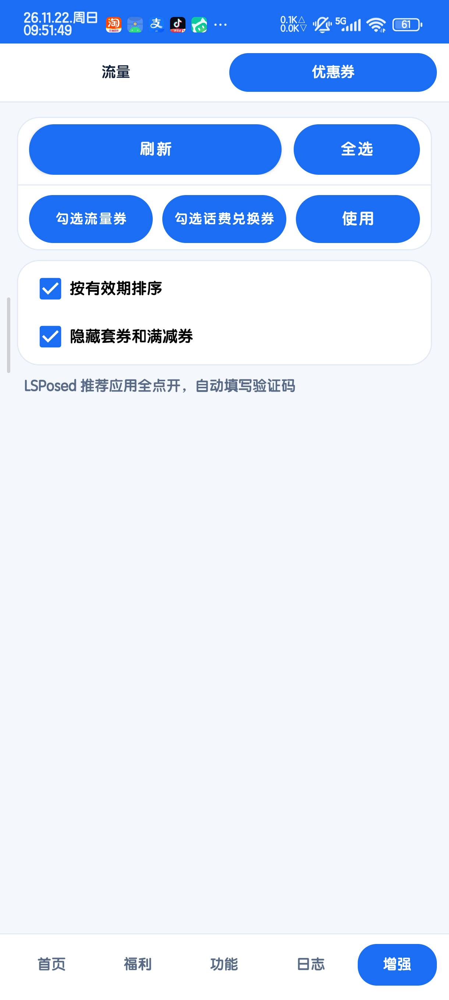

  <picture>
    <source media="(prefers-color-scheme: dark)" srcset="assets/banner-dark.png">
    
  </picture>

   

  
  
  

    

  [快速开始](#快速开始) · [功能](#功能) · [界面](#界面) · [内置活动](#内置活动) · [下载](#下载)

---

## 这是什么

一个装在本机、跟着中国移动 App 官方页面走的自动化助手：把签到、领券、抽奖、日常任务按页面里真实的操作流程跑一遍。**所有动作都在 App 自己的官方页面里完成，不伪造请求、不破解验证码、不拦截或改写短信。**

| 手动优先 | 只认真实回执 | 全程本机 |
| :--- | :--- | :--- |
| 默认由你点一下才执行，自动补跑是可选开关 | 刷新、查询不算完成，只有服务端真实提交成功或业务数据确实变了才记录 | 日志写入 App 私有目录，导出由你手动完成，不自动上传任何数据 |

## 快速开始

> [!IMPORTANT]
> 适用环境：**Android 8.1+**、已激活 LSPosed（或兼容框架）、中国移动 App **11.9.1**。模块本身**不需要 root**。
> 当前模块包名 `com.cmcchook`，与早期版本**不是同一个应用、无法覆盖安装**：先卸载旧版再装，并在 LSPosed 里重新启用、重新勾选作用域。

1. 从 [Releases](https://github.com/fuoins/cmcc-hook/releases/latest) 下载最新版 APK 安装。
2. LSPosed 管理器 → 模块 → 启用「移动签到助手」，作用域**只勾选「中国移动」**（不需要勾「电话服务」）。
3. 强制停止中国移动 App（或重启手机）→ 打开一次 → 回到模块首页，看到「运行中」和「最近心跳」即注入成功。

## 界面

五栏底部导航，Material 卡片布局，自动跟随系统深色模式；首页右上角是捐赠入口。

| | | |
| :---: | :---: | :---: |
|  |  |  |
| **首页** | **福利** | **功能** |
| 运行状态、今日结果、一键全做 | 活动清单、抢券板块、逐项执行 | 各项开关、抓包与过滤设置 |

| | |
| :---: | :---: |
|  |  |
| **增强 · 流量** | **增强 · 优惠券** |
| 流量余量明细、消耗测速 | 一键扫描、批量核销、隐藏不可用券 |

> 截图已做隐私处理，账号等敏感信息已打码。

## 功能

**福利活动**

- 内置活动清单，打开「福利」页即可看到名称、入口和接入状态，每行可在软件内打开、复制链接、采集页面信息。
- 单个活动点「执行任务」，或首页「立即全部跑一次」串行跑完；同一活动当天成功过就跳过。
- 只认服务端真实回执，遇到风控或页面数据没就绪会如实写「未确认」，不消耗当天机会。
- 跑完只关掉模块自己打开的那个页面，你手动开的页面一律不动。
- 抢券有专门板块：周三 88 元话费券（每周三 08:00）、12 点话费券（每天 12:00）。提前进去会在页面等到开抢，过点进去就直接试；这两项**不参与「一键全做」**。

**流量**

- 分类 → 套餐 → 每一包流量逐条列出，含套餐名、有效期、总量 / 已用 / 剩余，共享流量单独一列。
- 进页自动刷新一次，切页必刷；渐变头部卡片显示剩余大字与占比条。
- 消耗测速：选源后开始消耗，四线程下载、到阈值自动停，显示出口 IP。
- 领取入口分组列出官方活动入口，点击用系统浏览器打开自行领取，模块不代领。测速会真实产生流量，累计字节不等于计费值。

**优惠券**

- 一键扫描：在官方「我的卡券」页里读券，界面不跳前台，扫完自动关掉本轮自己开的页。
- 隐藏不可用券：把满减 / 折扣 / 待生效 / 已失效 / 已使用等不可用的券藏起来，只留能批量使用的流量券与话费兑换券。
- 批量核销：流量券 / 话费兑换券可批量使用；验证码自动读取短信填入（需系统短信权限），不授权就手动输入。小米 / HyperOS 读不到码时券页有自检入口。

**其他**

- 自动关广告（默认开）、拦升级弹窗；日志一键导出，可选「精简 / 只看任务 / 完整」。

## 内置活动

装上即可看到完整清单。状态：**已接入** = 按页面流程执行完成；**部分接入** = 只跑其中若干任务；**待适配** = 已有名字与地址、执行逻辑未写；**仅手动** = 需要本人决定，模块不代做。

| 活动 | 状态 |
| :--- | :--- |
| 签到有礼 | 已接入 · 签到、累计 / 连签 / 组队 / 月签、任务奖励、浏览任务 |
| 天天砸金蛋 | 已接入 · 浏览任务换次数并抽完 |
| 收鹅蛋换好礼、周周有好礼、签到抽奖 | 已接入 · 打卡 / 领饲料 / 投喂 / 收蛋、翻牌抽奖 |
| 幸运三日签、周三签到、AI 豆苗、乡友答题、球赛 / 追剧 / 游戏中心 | 已接入或部分接入 · 按各自页面流程执行 |
| 充值先领券、百 GB 等部分活动 | 待适配 · 已有名字与地址，执行逻辑未写 |
| 拼团、发口令红包 | 仅手动 · 涉及成团、支付或发消息，模块不代做 |

> 活动换期、下架或服务端风控时，模块会如实报「未确认 / 风控」，不会记成成功。服务端说今天已做过即算完成，遇风控回执立即停止、不重试。

## 结果怎么看

- **查询不算完成**：刷新、列表 / 状态查询都不算做了任务，只有真实提交成功或业务数据确实变了才记完成。
- **零提交不消耗机会**：没发出任何提交且数据没变，会写「未确认」，当天机会还在，可以重跑。
- **数据没就绪不空跑**：首屏还在「加载中」时如实报没做成，不会用一串「跳过」凑出「已跑完一轮」。

## 原则与隐私

- 不破解验证码，不伪造请求、签名或票据；验证码来自系统短信。
- 不代做需要真实意愿的动作：充值、办理、购买、成团、发消息、跳第三方 App 拉新一律跳过。
- 默认手动，自动补跑是可选开关；只在本机运行，不自动上传任何数据。

> [!WARNING]
> 导出的日志含 **Cookie、Token、Authorization 和手机号**，泄露等同于账号被他人使用。请只发给可信的人，不要传到公开网盘或群聊。自动化操作也可能触发运营商风控，请自行评估。

## 下载

| 内容 | 地址 |
| :--- | :--- |
| 模块 APK（最新版） | [Releases](https://github.com/fuoins/cmcc-hook/releases/latest) |
| 中国移动 11.9.1 客户端 | [下载安装包](https://github.com/fuoins/cmcc-hook/releases/download/v3.98/com.greenpoint.android.mc10086.activity_11.9.1_119101.apk) |

升级前请看 [快速开始](#快速开始) 里的包名提醒。本仓库只提供构建产物与说明，源码与构建配置不在本仓库。

## 免责声明

> [!CAUTION]
> **仅供学习与技术交流，严禁任何商业用途；禁止倒卖、售卖本模块或其衍生版本。** 使用产生的一切后果由使用者自行承担，开发者概不负责。如有侵权请联系删除。下载即代表你同意以上声明。

---

  移动签到助手 &nbsp;·&nbsp; 仅供学习与技术交流 &nbsp;·&nbsp; 请勿用于任何商业用途

