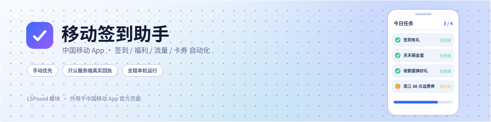

  <picture>
    <source media="(prefers-color-scheme: dark)" srcset="assets/banner-dark.png">
    
  </picture>

    

  
  
  
  
  
  
  

    

  <b><a href="#quickstart">🚀 快速开始</a></b> &nbsp;·&nbsp;
  <b><a href="#features">🧩 功能</a></b> &nbsp;·&nbsp;
  <b><a href="#download">📥 下载</a></b> &nbsp;·&nbsp;
  <b><a href="#disclaimer">⚠️ 免责声明</a></b>

 

> [!NOTE]
> 这是一个作用于**中国移动 App** 的 LSPosed 模块。所有动作都在 App 自己的官方页面里完成；模块不伪造请求、不破解验证码、不拦截或改写短信。

**把中国移动 App 里的签到、领券、抽奖和日常任务，按页面里真实的操作流程帮你跑一遍。**

> 手动执行优先 · 只认服务端真实回执 · 不代做需要你本人决定的操作

---

## 📖 目录

|  |  |
| :--- | :--- |
| [✨ 这是什么](#overview) · 三条设计边界 | [🚀 快速开始](#quickstart) · 三步跑起来 |
| [🎯 一眼看懂](#at-a-glance) · 想做的事去哪点 | [📱 界面一览](#screens) · 五个页面 |
| [🧩 功能](#features) · 福利 / 流量 / 优惠券 / 小功能 | [📋 内置活动](#activities) · 活动清单与状态 |
| [✅ 结果怎么看](#rules) · 什么才算「完成」 | [⚙️ 安装与启用](#install) · 详细步骤与包名提醒 |
| [🔐 使用原则与隐私](#privacy) · 边界与日志风险 | [📥 下载与版本](#download) · APK 与全部版本 |
| [⚠️ 免责声明](#disclaimer) · 使用前必读 | [🏠 仓库首页](https://github.com/fuoins/cmcc-hook) · 返回项目主页 |

---

## ✨ 这是什么

一个装在本机、跟着中国移动 App 官方页面走的自动化助手：把签到、领券、抽奖、日常任务按页面里真实的操作流程跑一遍，同时把流量余量和卡券整理成能一眼看懂的卡片。

| 🖐️ 手动优先 | ✅ 只认真实回执 | 🔒 全程本机运行 |
| :--- | :--- | :--- |
| 默认由你点一下才执行，每天自动补跑只是一个可选开关 | 页面刷新、列表查询都不算完成，只有服务端真实提交成功或业务数据确实变了才记录 | 日志写入 App 私有目录，导出由你手动完成，模块不自动上传任何数据 |

## 🎯 一眼看懂

| 你想做的事 | 去哪一页 | 怎么点 |
| :--- | :--- | :--- |
| 跑某一个活动 | 福利 | 点开活动 → 执行任务 |
| 一次跑完所有活动 | 首页 | 立即全部跑一次 |
| 看流量还剩多少 | 增强 → 流量 | 进页自动刷新，也可手动点「刷新」 |
| 扫描卡券 / 使用券 | 增强 → 优惠券 | 一键扫描 / 使用 |
| 看今天做没做成 | 首页 | 「今日」行显示 ✓ / ✗ / ○ |
| 排查问题 | 日志 | 导出完整日志 |

## 🚀 快速开始

> [!TIP]
> **适用环境**：Android 8.1 及以上、已激活 LSPosed（或兼容框架）、中国移动 App 11.9.1。模块本身**不需要 root 权限**。

1. **装** — 从 [Releases](https://github.com/fuoins/cmcc-hook/releases/latest) 下载最新版 APK 并安装。
2. **启用** — LSPosed 管理器 → 模块 → 启用「移动签到助手」，作用域**只勾选「中国移动」**（不需要勾「电话服务」）。
3. **验证** — 强制停止中国移动 App（或重启手机）→ 打开一次中国移动 App → 回到模块首页，看到「**运行中**」和「最近心跳」即注入成功。

> [!IMPORTANT]
> 当前包名是 `com.cmcchook`，与早期版本**不是同一个应用，无法覆盖安装**：先卸载旧版再装新版，并在 LSPosed 里重新启用、重新勾选作用域。完整说明见 [安装与启用](#install)。

## 📱 界面一览

五栏底部导航，Material 卡片布局，自动跟随系统深色模式；标题栏右上角是捐赠入口。

| 页面 | 内容 |
| :--- | :--- |
| **首页** | 运行状态、今日结果、立即全部跑一次、关于与免责声明 |
| **福利** | 活动清单、抢券板块、每个活动的入口与执行 |
| **功能** | 各项开关（自动关广告、自动补跑、短信权限自检等） |
| **日志** | 按标签筛选、展开完整记录、导出 |
| **增强** | 底部切换「流量 / 优惠券」两个子页 |

## 🧩 功能

### 🎁 福利活动

| 能力 | 说明 |
| :--- | :--- |
| 活动清单 | 内置活动表，打开「福利」页就能看到名称、入口和接入状态；每行都可以在软件内打开、复制链接、采集页面信息 |
| 执行方式 | 单个活动点「执行任务」，或首页「立即全部跑一次」串行跑完；也可以先自己进页面再执行 |
| 自动补跑 | 可选每天自动补跑一次；同一活动当天成功过就跳过 |
| 结果验收 | 只认服务端真实回执，查询和刷新不算完成；遇到风控或页面数据没就绪会如实写「未确认」 |
| 跑完收页 | 每个活动结束后，模块只关掉自己打开的那个页面，你手动开的页面一律不动 |

> [!TIP]
> **抢券有专门板块**：周三 88 元话费券（每周三 08:00）、12 点话费券（每天 12:00）。提前进去会在页面上等到开抢，过点进去就直接试，倒计时实时显示在状态行。这两项**不参与「一键全做」**，免得赶不上开抢时间。

### 📊 流量

| 能力 | 说明 |
| :--- | :--- |
| 全量明细 | 分类 → 套餐 → 每一包流量逐条列出，含套餐名、有效期、总量 / 已用 / 剩余，共享流量单独一列 |
| 自动刷新 | 进页自动刷新一次，切页必刷；每一步进度都写在状态行 |
| 卡片界面 | 渐变头部显示剩余大字 / 已消耗 / 占比条；「流量详情」逐项展开，点分类卡再展开该组每一包，下面是账户信息（话费 / 通话） |
| 消耗测速 | 选测速源后「开始消耗」，四线程下载、到阈值自动停，可手动停止 / 重置，显示出口 IP |
| 领取入口 | 分组列出官方活动入口，点击用系统浏览器打开活动页自行领取；模块不代领 |

> [!IMPORTANT]
> 消耗测速与领取入口**完全独立**，不依赖余量数据，没查到余量也能用。测速会真实产生流量，连 WiFi 时消耗的是 WiFi；累计字节不等于计费值，活动有地域和资格限制。

### 🎟️ 优惠券

| 能力 | 说明 |
| :--- | :--- |
| 一键扫描 | 点整行的「一键扫描」，模块在官方「我的卡券」页里读券，界面不跳前台、不用你手动进卡券中心，扫完自动关掉本轮自己开的页 |
| 隐藏不可用券 | 按钮仍叫「隐藏满减券」，实际把所有不可用的券都藏起来（满减 / 折扣 / 加赠、待生效、已失效、已使用、会员权益券），只留能批量使用的流量券与话费兑换券 |
| 批量核销 | 流量券 / 话费兑换券可以批量使用；验证码可以自动读取短信填入，不授权就手动输入 |
| 小米自检 | 小米 / HyperOS 读不到验证码时，券页有自检入口，把需要开的系统设置一条条列出来 |

### 🛠️ 更省心的小功能

| 功能 | 说明 |
| :--- | :--- |
| 自动关广告 | 默认开启，关闭开屏广告与首页弹窗广告；开关在「功能」页 |
| 去升级弹窗 | 拦掉中国移动 App 的升级提示与版本检查红点 |
| 日志导出 | 一键导出，可选「精简 / 只看任务 / 完整」，另有「详细原始返回」开关 |
| 界面 | 首页 / 福利 / 功能 / 日志 / 增强 五栏，Material 卡片布局，自动跟随系统深色模式；标题栏右上角是捐赠入口 |

## 📋 内置活动

活动表已经内置，装上就能看到完整清单。状态说明：**已接入** = 按页面流程执行完成；**部分接入** = 只跑其中若干任务；**待适配** = 已有名字与地址、执行逻辑未写；**仅手动** = 需要本人决定，模块不代做。

| 活动 | 状态 |
| :--- | :--- |
| 签到有礼 | 已接入 · 签到、累计 / 连签 / 组队 / 月签、任务奖励、浏览任务 |
| 天天砸金蛋 | 已接入 · 浏览任务换次数，再把次数抽完 |
| 收鹅蛋换好礼 | 已接入 · 打卡、领饲料、投喂、收蛋、领任务、出游归来领取 |
| 周周有好礼 / 签到抽奖赢好礼 | 已接入 · 做浏览任务、翻牌抽奖 |
| 幸运三日签、周三签到、AI 豆苗、乡友答题、球赛 / 追剧 / 游戏中心等 | 已接入或部分接入 · 按各自页面流程执行 |
| 充值先领券、百 GB、部分活动 | 待适配 · 已有名字与地址，执行逻辑未写 |
| 拼团、发口令红包 | 仅手动 · 涉及成团、支付或发消息，模块不代做 |

> [!NOTE]
> 活动换期、下架或服务端风控时，模块会如实报「未确认 / 风控」，不会记成成功。

## ✅ 结果怎么看

- **查询不算完成。** 页面刷新、列表查询、状态查询都不算做了任务；只有真实提交成功、或页面里的业务数据确实变了，才记完成。
- **零提交不消耗机会。** 没发出任何提交且数据没变化，会写「未确认」，当天的活动机会还在，可以重跑。
- **数据没就绪不空跑。** 首屏还在「加载中」时如实报没做成，不会用一串「跳过」凑出「已跑完一轮」。
- **服务端说今天已做过，就算完成**；遇到风控回执立即停止，不重试。

## ⚙️ 安装与启用

1. 安装 [全部版本](https://github.com/fuoins/cmcc-hook/releases) 中的 APK。
2. 打开 LSPosed 管理器 → 模块 → 启用「移动签到助手」。
3. 在作用域里勾选「中国移动」，这一项就够了，不需要额外勾选「电话服务」。
4. 强制停止中国移动 App，或直接重启手机，让模块重新注入。
5. 打开一次中国移动 App，再回到模块首页：状态显示「运行中」并有「最近心跳」即注入成功。

> [!IMPORTANT]
> 当前包名是 `com.cmcchook`。早期版本用的是另一个包名，属于不同应用，**无法覆盖安装**：先卸载旧版再装新版，LSPosed 里也要重新启用模块、重新勾选作用域。每次升级后都建议强停中国移动 / 重启一次，并在日志头确认版本号是新的。

**适用环境**：Android 8.1 及以上、已激活 LSPosed（或兼容框架）、中国移动 App 11.9.1。模块本身不需要 root 权限。

## 🔐 使用原则与隐私

### 使用原则

- 不破解验证码，不伪造请求、签名或票据；验证码来自系统短信。
- 不代做需要真实意愿的动作：充值、办理、购买、成团、发消息、跳第三方 App 拉新一律跳过，只做签到 / 领取 / 浏览 / 投喂这类页面内动作。
- 默认手动，自动补跑是可选开关。
- 只在本机运行：日志写入 App 私有目录，导出由你手动完成，模块不自动上传任何数据。

### 隐私提醒

> [!WARNING]
> 导出的日志含有 **Cookie、Token、Authorization 和手机号**，泄露等同于账号被他人使用。请只发给可信的人，不要上传到公开网盘或群聊。自动化操作也可能触发运营商账号风控，请自行评估。

## 📥 下载与版本

| 内容 | 地址 |
| :--- | :--- |
| 全部版本 | [Releases](https://github.com/fuoins/cmcc-hook/releases) |
| 中国移动 11.9.1 | [下载安装包](https://github.com/fuoins/cmcc-hook/releases/download/v3.98/com.greenpoint.android.mc10086.activity_11.9.1_119101.apk) |

> 这里只提供「中国移动 11.9.1」这一个客户端安装包；模块 APK 请在 Releases 中按需选择。

包名 `com.cmcchook`，升级前请先看 [安装与启用](#install) 里的包名提醒。

## ⚠️ 免责声明

> [!CAUTION]
> **本模块仅供学习与技术交流使用，严禁用于任何商业用途。**
>
> 1. 本模块为开源项目，代码仅供学习研究，不得用于商业牟利；
> 2. 禁止以任何形式倒卖、售卖本模块或其衍生版本；
> 3. 使用本模块产生的一切后果由使用者自行承担，开发者概不负责；
> 4. 本模块不收集任何用户数据，所有操作均在本地完成；
> 5. 如有侵权，请联系删除。
>
> **下载即代表您同意以上声明。**

---

  <b>移动签到助手</b> &nbsp;·&nbsp; 仅供学习与技术交流 &nbsp;·&nbsp; 请勿用于任何商业用途

